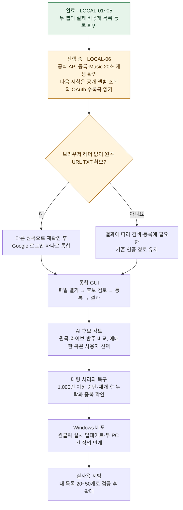

# 재생목록 앱 개발 로드맵

## 단계별 작업과 완료 기준

### 0. 두 앱의 실제 등록 검증

현재 Streamlit 앱 두 개를 제품 개발의 출발점으로 사용한다.

**할 일**

- LOCAL-01~02에서 양쪽 PC의 URL 중복 제거, 빠른 링크 생성, 재시작 후 작업 복원을 확인했다.
- LOCAL-03~04에서 윤하 원곡 1곡을 수동 확정해 실제 비공개 목록에서 확인했다. 아이유 곡은 원곡이 불확실해 사용자가 건너뛰었다.
- LOCAL-05에서 일반 영상 키워드 검색, 원본 자동 확정, OAuth 등록과 브라우저의 단일 항목 표시를 확인했다.

**판정 기준**

- 실제 계정 검증은 서비스별 1건이다. 대량 복구는 모의 API 시험 범위다.
- 집 PC에서 비공개 목록 본문이 비었던 원인은 미확인이다. 직장 PC에서 같은 목록과 곡을 확인했다.

담당 · 클라우드 구현 · 집·직장 PC 검증 완료

### 1. 음원도 Google 로그인 하나로 가능한지 확인

윤하 〈사건의 지평선〉의 등록과 재생을 확인했다. 남은 검증은 사용자가 브라우저 헤더를 복사하지 않고 원곡을 찾아 URL을 내보낼 수 있는지다.

**검증 결과와 다음 시험**

- 직장 PC에서 기준 원곡을 공식 OAuth로 비공개 재생목록에 등록하고 YouTube Music에서 20초간 재생했다.
- LOCAL-06-R2에서 한국어·영어 곡 검색은 0행, 통합 검색은 17행이었고 원곡은 없었다. 윤하 리패키지 앨범을 찾았으나 내보낼 트랙이 0개여서 TXT는 미생성이다. 원본 트랙 수는 미확인이다.
- LOCAL-06-R3에서는 곡 검색을 생략하고 앨범명으로 공개 조회해 원본·제외 수와 이유를 확인한다. 공개 응답이 OLAK ID를 제공하면 영상 앱에서 기존 Google OAuth로 공식 API 수록곡을 읽고, 기준 원곡을 선택해 한 줄 URL TXT를 대조한다.

**판정 기준**

- 윤하 원곡의 검색·TXT 검증을 통과하면 다른 아티스트의 원곡으로 재확인한다. 두 번째 아티스트 시험은 대기 중이다.
- 다른 아티스트까지 확인한 뒤 Google 로그인 하나로 검색부터 등록까지 진행할 수 있는지 판정한다. 공개 앨범 탐색과 기존 OAuth로 읽은 수록곡의 실기 결과를 각각 기록한다.

담당 · 클라우드에서 앨범 조회 구현 · 직장 PC에서 공개 응답·OAuth 조회·TXT 확인

### 2. 파일 하나로 시작하는 통합 화면

두 앱의 파일 읽기, 검색, 등록, SQLite 체크포인트를 재사용해 사용자가 한 창에서 작업을 마치게 한다.

**할 일**

- 첫 화면에는 새 파일 열기와 저장된 작업 이어하기를 둔다. 음원·영상 선택, 추천 열 매핑과 수정, 선택 범위와 중복 수를 한 흐름에 배치한다.
- 등록 직전에 대상 채널, 새 목록 또는 기존 목록, 공개 범위, 등록 예정 수를 보여준다. 등록 후 결과 링크와 실패 항목을 제공한다.
- 기존 버전에서 저장한 작업 사본으로 열기와 재개를 시험한다. 앱별 등록 방식과 무인증 빠른 링크도 계속 사용할 수 있게 한다.

**판정 기준**

- 같은 내용의 MD·CSV(CP949 포함)·XLSX·TXT 표본에서 원본·중복·선택 수가 맞는다.
- 사용자가 한글 경로의 파일을 열어 열 매핑을 수정하고 등록 미리보기와 결과까지 한 창에서 도달한다.

담당 · 클라우드에서 GUI 구현 · 직장 PC에서 사용자 흐름 확인

### 3. 애매한 곡을 도와주는 AI

잘못된 자동 등록을 줄이면서 사용자가 직접 비교해야 하는 곡 수를 측정한다.

**할 일**

- 기존 검색·유사도 점수를 기준선으로 쓴다. AI에는 입력 열 또는 실제 검색 후보의 제목·가수·앨범 등 판단에 필요한 정보만 제공한다. 쿠키와 OAuth 토큰은 제외한다.
- AI는 반환된 후보 ID 안에서 추천하고 판단 근거를 한 줄로 표시한다. 사용자는 원곡 확정·다시 검색·건너뛰기를 선택할 수 있다.
- 원곡·반주·동명이곡·표기 차이 예시와 아이유 ‘밤편지’처럼 판단을 보류한 사례로 평가한다. 모델 선택 시 한국어 성능, 응답시간, 100곡당 비용, 외부 전송 범위를 비교한다.

**판정 기준**

- 사람이 판정한 예시 50건으로 기존 점수 방식과 AI 방식의 오등록 수와 수동 검토 수를 비교한다. 자동 확정 확대는 오등록을 늘리지 않으면서 검토 건수를 줄였을 때만 적용한다.
- 후보가 없거나 모델이 응답하지 않아도 수동 검토와 일반 검색으로 작업을 끝낼 수 있다.

담당 · 클라우드에서 후보·평가 구현 · 사용자가 애매한 표본 판정

### 4. 대량 작업과 중단 후 이어하기

이미 등록한 항목을 다시 올리지 않고 멈춘 지점부터 계속한다.

**할 일**

- 모의 API와 임시 DB로 검색 도중 종료, 등록 직후 응답 유실, 429, quotaExceeded, 두 창의 동시 실행을 각각 재현한다.
- 대상 목록 ID와 항목별 상태를 보관하고 재개 전에 원격 ID를 대조한다. 남은 건수와 예상 API 사용량을 표시한다.
- 실계정에서는 기존 영상 1건과 신규 영상 1건을 넣고 재개해 중복 방지를 확인한다. 대량 시험은 모의 API로 수행한다.

**판정 기준**

- 1,000건 이상 표본의 중단·재개 후 누락과 중복 등록이 각각 0건이고 CSV 결과가 DB·모의 원격 목록과 일치한다.
- 일일 한도 오류에서 등록이 중지되고 저장된 대상에 재개한다. 사용자 화면에서 실패·검토·대기가 구분된다.

담당 · 클라우드에서 부하·복구 시험 · 직장 PC에서 소량 실계정 대조

### 5. Windows 설치와 두 PC 간 인계

설치 안내와 양쪽 PC 사이의 프롬프트 전달을 일상 사용에서 없앤다.

**할 일**

- Python 런타임과 필요한 패키지를 포함한 Windows 배포본을 만들고 시작 메뉴에서 앱을 연다. 앱 데이터와 설치 파일을 분리한다.
- 업데이트 전 작업 백업과 복원을 넣는다. PC 간 이동은 명시적인 작업 내보내기·가져오기로 시작하고 인증은 각 PC에서 수행한다.
- 개인 시험은 현재 OAuth 테스트 클라이언트를 쓴다. 외부 사용자 배포 전에는 데스크톱 클라이언트, 동의 화면, 필요한 Google 검증 및 프로젝트 쿼터를 확인한다.

**판정 기준**

- Python이 없는 Windows 사용자 환경과 한글 경로에서 설치→실행→업데이트 후 작업 복원이 통과한다.
- 한 PC에서 멈춘 시험 작업을 다른 PC로 가져와 같은 채널·대상·진행 수를 확인한다. 내보낸 파일에 인증 정보가 포함되지 않는다.

담당 · 클라우드에서 패키징 코드 작성 · Windows에서 빌드 · 직장·집에서 인수 시험

### 6. 내 실제 목록으로 소규모 시범

사용자가 개발자의 안내 없이 자신의 파일로 원하는 재생목록을 만든다.

**할 일**

- 사용자가 고른 음원·영상 파일에서 20~50개를 골라 비공개로 시험한다. 새 목록과 기존 목록 추가를 각각 확인한다.
- 처음 실행부터 결과까지 걸린 시간, 사람이 고친 곡, 스킵 사유, 외부 계정에 실제 반영된 수를 기록한다.
- 실제 공개 범위와 리포트를 확인하고 우선 수정할 불편을 정한다. 결과가 맞으면 사용자가 원하는 범위로 늘린다.

**판정 기준**

- 원하는 버전이 들어갔는지 표본을 들어 보고, 확정·스킵·실패·중복 건수와 실제 목록의 추가분이 서로 맞는다.
- 두 PC에서 사용자 가이드만으로 새 작업 생성과 이어하기를 완료하면 개인용 첫 배포판의 인수 시험을 마친다.

담당 · 사용자가 실제 목록으로 사용 · 클라우드에서 문제 수정
