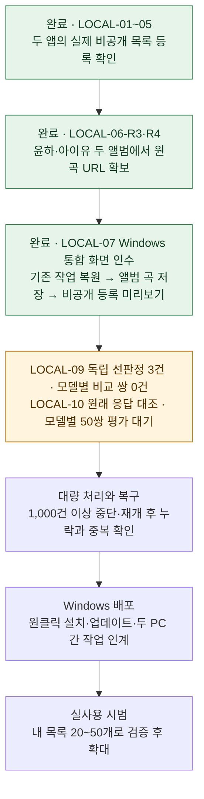

# 재생목록 앱 개발 로드맵

## 단계별 작업과 완료 기준

### 0. 두 앱의 실제 등록 검증

현재 Streamlit 앱 두 개를 제품 개발의 출발점으로 사용한다.

**할 일**

- LOCAL-01~02에서 양쪽 PC의 URL 중복 제거, 빠른 링크 생성, 재시작 후 작업 복원을 확인했다.
- LOCAL-03~04에서 윤하 원곡 1곡을 수동 확정해 실제 비공개 목록에서 확인했다. 아이유 곡은 원곡이 불확실해 사용자가 건너뛰었다.
- LOCAL-05에서 일반 영상 키워드 검색, 원본 자동 확정, OAuth 등록과 브라우저의 단일 항목 표시를 확인했다.

**판정 기준**

- 실제 계정 검증은 서비스별 1건이다. 대량 복구는 모의 API 시험 범위다.
- 집 PC에서 비공개 목록 본문이 비었던 원인은 미확인이다. 직장 PC에서 같은 목록과 곡을 확인했다.

담당 · 클라우드 구현 · 집·직장 PC 검증 완료

### 1. 음원도 Google 로그인 하나로 가능한지 확인

두 아티스트의 앨범을 공개 검색에서 골라 기존 Google OAuth로 수록곡을 읽고 원곡의 영상 ID를 확보했다.

**검증 결과**

- 앞선 LOCAL-06에서는 동봉 TXT로 등록한 윤하 원곡을 YouTube Music에서 20초간 재생했다.
- LOCAL-06-R3에서 윤하 리패키지의 공개 응답은 14개 모두 이용 불가였으나 공식 API 응답 14개 모두 내보낼 수 있었다. 11번 Event Horizon / Younha - Topic의 영상 ID j1uXcHwLhHM을 한 줄 TXT와 대조했다.
- LOCAL-06-R4(직장 PC 80e9db7)에서는 10개 앨범 결과 중 1번 IU / Palette를 선택했다. 공개 수록곡 10개가 모두 이용 불가였으나 기존 OAuth의 공식 API 응답은 10개 모두 내보낼 수 있었다.

**판정 기준**

- R4의 8번 Through the Night (밤편지) / IU - Topic을 제목과 채널로 고른 후 응답에서 영상 ID 6744glqD6lk를 얻었다. 내장 브라우저에서 받은 UTF-8 TXT는 44바이트, URL 한 줄이었고 그 ID와 일치했다.
- 윤하·아이유의 독립 표본 2건이 통과해 통합 화면에 공개 앨범 검색과 기존 OAuth 수록곡 조회를 채택했다. R3·R4는 새 로그인이나 재생목록 쓰기 없이 마쳤다.

담당 · 직장 PC · 두 아티스트의 원곡 선택과 TXT 대조 완료

### 2. 파일 하나로 시작하는 통합 화면

직장 PC의 e3cc8d3에서 루트 실행기 하나로 통합 화면을 열고 로컬 작업 복원부터 등록 미리보기까지 확인했다.

**Windows 인수 결과**

- 영상 작업 #3의 원본 기록과 빠른 링크를 확인했다. 직장 PC에 이전 음원 작업이 없어 기존 음원 작업의 복원 사례는 없었다.
- 영상 작업 #4는 같은 영상의 URL 2개에서 중복 1개를 제외하고 1개를 저장했다. 다시 열어서 같은 결과와 빠른 링크를 확인했다.
- 아이유 / 밤편지 / Palette 입력 행에서 공식 수록곡을 선택해 TXT 전달 없이 영상 작업 #5를 만들었다. 작업의 영상 ID 6744glqD6lk가 선택한 공식 응답 행과 일치했다.

**판정 기준**

- LOCAL-07의 통합 흐름에서 기존 작업, 신규 중복 영상 작업과 앨범 작업이 한 창에서 열렸다. Windows 인수 시험을 통과했다.
- 비공개 목록의 등록 미리보기에서 예정 1건을 확인했다. 새 로그인이나 실제 목록 쓰기는 없었고 종료 후 8503 포트가 닫혔다.
- LOCAL-07의 실기 표본은 중복 URL의 TXT와 음원 CSV였다. 같은 내용의 마크다운·CSV(UTF-8·CP949)·XLSX·TXT 표본을 한글 경로에서 열어 원본·중복·선택 수와 열 매핑 수정 결과를 대조하는 전체 형식 시험은 별도로 남아 있다.

담당 · 직장 PC · LOCAL-07 Windows 인수 검증 완료

### 3. 애매한 곡을 도와주는 AI

현재 음원 입력 행의 곡명·가수·앨범과 공식 API가 반환한 수록곡으로 모델이 후보 하나를 추천하거나 판단을 보류한다. 최종 트랙 선택은 사용자가 별도로 한다.

**실기 결과와 다음 시험**

- LOCAL-08 직장 PC에서 아이유의 Palette 공식 수록곡 10개를 검토했다. Codex는 밤편지의 영상 ID 6744glqD6lk를 추천했고 기존 유사도 판정은 보류했다. 추천 뒤에도 트랙 선택은 비어 있었다.
- 앱은 잘못된 JSON, 다른 사례 ID, 후보에 없는 영상 ID가 담긴 응답을 거부했다. 새 로그인이나 원격 재생목록 쓰기 없이 Windows 기능 시험을 통과했다. 사용한 Codex 모델 이름은 미확인이며, LOCAL-08은 독립 선판정과 모델 응답을 짝지은 평가 건수에서 제외한다.
- 직장 PC의 LOCAL-09(9c08296)에서 사람이 새 사례 3건을 먼저 판정해 2건을 선택하고 1건을 보류했다. 같은 사례에서 유사도 기준선의 오추천은 0건이었고, 3건 모두 수동 검토로 남겼다.
- 모델 이름을 확인하지 못한 Codex 응답 3건이 앱의 검증을 통과했다. 후보 추천 2건과 보류 1건이었다. 사람 판정과 차이가 1건이라고 회신했으나 해당 사례는 특정되지 않아 원인과 오추천 여부는 미확인이다.
- LOCAL-10에서는 기존 사람 판정을 보존한다. 원본 응답 JSON이 없으면 ‘원본 미확인’으로 기록한다. 이때 원래 요청이나 동일한 입력·후보의 현재 요청에서 곡과 연결된 전체 case_id가 기존 사람 판정 파일과 일치할 때만 이미 보고된 선택·보류를 ‘보고값 대조’로 기록한다. 앨범이나 파일 순서만으로 사례를 연결하지 않는다.
- 원본 JSON은 사례 ID를 확인해 읽기 전용으로 대조한다. 모델명이 확인된 재실행은 선택 사항이다. 사람 판정·기준선·기존 답을 가린 입력을 제공하고 같은 case_id의 새 응답을 후속 결과로 따로 기록한다.

**판정 기준**

- 사람의 선판정과 유사도 기준선은 모델 실행 여부나 이름 확인 여부와 관계없이 한 사례로 보관한다. 동일한 사례에 실제 모델 응답과 확인된 모델 이름이 있을 때만 모델별 비교 쌍으로 집계한다.
- 현재 이름이 확인된 모델의 비교 쌍은 0건이다. 사람의 독립 선판정과 같은 사례의 응답을 모델별로 50쌍씩 확보한 뒤 tools/evaluate_ai_reviews.py로 기준선과 오추천·보류 수를 비교한다. 원곡·라이브·반주·동명이곡을 포함한 50쌍 평가와 실제 수동 검토 건수 비교는 대기 중이다.
- 자동 확정의 범위를 넓히려면 기준선 대비 오등록이 늘지 않고 사람의 검토 건수가 줄었음을 확인해야 한다. 그때까지 모델 권고는 참고용이며, 도구가 자동으로 정책을 변경하지 않는다.
- 모델 선택 전 한국어 곡명·가수명에 대한 판단 정확도, 응답 시간, 100곡당 비용, 각 방식에서 로컬에 남거나 외부로 전달되는 정보를 확인한다. 실제 모델별 속도·비용·개인정보 비교는 남아 있다.
- 모델이 보류하거나 실패해도 사람이 수동 선택을 계속할 수 있어야 한다. 사용자가 직접 건너뛴 시험 행은 다시 열어 이전 상태로 복구할 수 있어야 한다.

담당 · 직장 PC · LOCAL-09 선판정 3건 완료 · LOCAL-10 원래 응답 대조 대기

### 4. 대량 작업과 중단 후 이어하기

이미 등록한 항목을 다시 올리지 않고 멈춘 지점부터 계속한다.

**할 일**

- 모의 API와 임시 DB로 검색 도중 종료, 등록 직후 응답 유실, 429, quotaExceeded, 두 창의 동시 실행을 각각 재현한다.
- 대상 목록 ID와 항목별 상태를 보관하고 재개 전에 원격 ID를 대조한다. 남은 건수와 예상 API 사용량을 표시한다.
- 실계정에서는 기존 영상 1건과 신규 영상 1건을 넣고 재개해 중복 방지를 확인한다. 대량 시험은 모의 API로 수행한다.

**판정 기준**

- 1,000건 이상 표본의 중단·재개 후 누락과 중복 등록이 각각 0건이고 CSV 결과가 DB·모의 원격 목록과 일치한다.
- 일일 한도 오류에서 등록이 중지되고 저장된 대상에 재개한다. 사용자 화면에서 실패·검토·대기가 구분된다.

담당 · 클라우드에서 부하·복구 시험 · 직장 PC에서 소량 실계정 대조

### 5. Windows 설치와 두 PC 간 인계

설치 안내와 양쪽 PC 사이의 프롬프트 전달을 일상 사용에서 없앤다.

**할 일**

- Python 런타임과 필요한 패키지를 포함한 Windows 배포본을 만들고 시작 메뉴에서 앱을 연다. 앱 데이터와 설치 파일을 분리한다.
- 업데이트 전 작업 백업과 복원을 넣는다. PC 간 이동은 명시적인 작업 내보내기·가져오기로 시작하고 인증은 각 PC에서 수행한다.
- 개인 시험은 현재 OAuth 테스트 클라이언트를 쓴다. 외부 사용자 배포 전에는 데스크톱 클라이언트, 동의 화면, 필요한 Google 검증 및 프로젝트 쿼터를 확인한다.

**판정 기준**

- Python이 없는 Windows 사용자 환경과 한글 경로에서 설치→실행→업데이트 후 작업 복원이 통과한다.
- 한 PC에서 멈춘 시험 작업을 다른 PC로 가져와 같은 채널·대상·진행 수를 확인한다. 내보낸 파일에 인증 정보가 포함되지 않는다.

담당 · 클라우드에서 패키징 코드 작성 · Windows에서 빌드 · 직장·집에서 인수 시험

### 6. 내 실제 목록으로 소규모 시범

사용자가 개발자의 안내 없이 자신의 파일로 원하는 재생목록을 만든다.

**할 일**

- 사용자가 고른 음원·영상 파일에서 20~50개를 골라 비공개로 시험한다. 새 목록과 기존 목록 추가를 각각 확인한다.
- 처음 실행부터 결과까지 걸린 시간, 사람이 고친 곡, 스킵 사유, 외부 계정에 실제 반영된 수를 기록한다.
- 실제 공개 범위와 리포트를 확인하고 우선 수정할 불편을 정한다. 결과가 맞으면 사용자가 원하는 범위로 늘린다.

**판정 기준**

- 원하는 버전이 들어갔는지 표본을 들어 보고, 확정·스킵·실패·중복 건수와 실제 목록의 추가분이 서로 맞는다.
- 두 PC에서 사용자 가이드만으로 새 작업 생성과 이어하기를 완료하면 개인용 첫 배포판의 인수 시험을 마친다.

담당 · 사용자가 실제 목록으로 사용 · 클라우드에서 문제 수정
